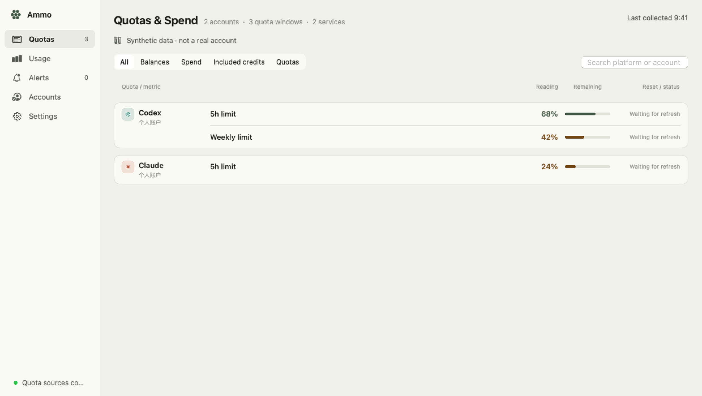
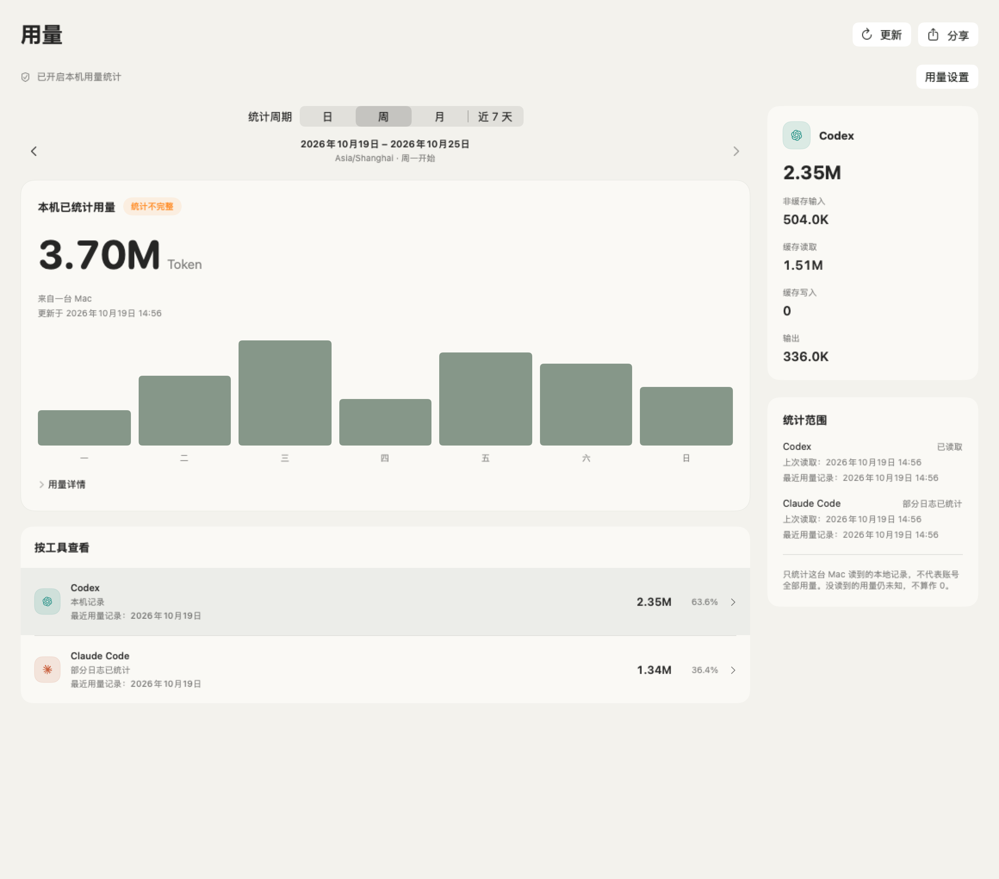
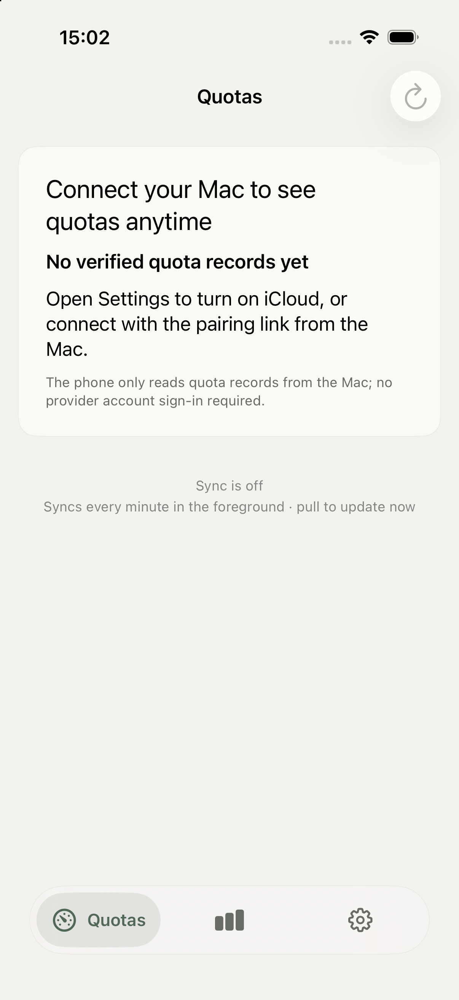

# Ammo Agent Usage

[English](README.md) | 简体中文

Ammo 是一款 macOS AI 额度监控工具，提供可选的 iPhone 伴侣应用、小组件、
实时活动、CLI 和 MCP 接口。每个供应商、每个账户分别保留额度窗口、计量单位、
数据时效和重置时间，不会把不同账户的余额合并成一个钱包。
用于设备同步的 Cloudflare Worker 可以自行部署。

**开发者预览版：** 开源代码不代表所有供应商、真机或后台更新场景都已完成验证。
请参阅[发布准备情况](docs/open-source-release.md)与[隐私说明](PRIVACY.md)。

## 界面预览

桌面截图由实际 SwiftUI 视图使用公开合成样例渲染，展示的额度和用量均为演示数据，
不是真实账户余额或账单。iPhone 截图来自未配对 Mac 的全新模拟器首次启动。

| 额度与支出 | 本机 Token 用量 |
| --- | --- |
|  |  |

<details>
<summary>iPhone 伴侣应用：首次启动</summary>



</details>

## 下载与体验

- **macOS：** 在成功的 [GitHub Actions 构建](https://github.com/hekmon8/ammo-agent-usage/actions/workflows/checks.yml)
  中下载 `Ammo-macOS-unsigned`，或按下方步骤自行编译。
  CI 产物是未签名的开发构建，不是已签名的正式发行版。
- **iPhone：** [加入 Ammo TestFlight 测试](https://testflight.apple.com/join/hzWVf8WM)。
  在 iPhone 上打开邀请，按 TestFlight 提示安装；能否加入取决于当前测试状态和剩余名额。
  维护者可参阅 [TestFlight 构建与分发文档](docs/github-actions.md)。
- `Ammo-iOS-Simulator` 只用于模拟器，不能直接安装到实体 iPhone。

## 本地构建

需要 Apple Silicon Mac、Xcode 26.2+ / Swift 6.2+、XcodeGen 2.43+、Node 22+
和 Python 3.11+。最低运行系统为 macOS 14、iOS 17。
已测试的工具版本记录在 [toolchain.json](toolchain.json)，Swift、Node 和 Python
依赖均提供版本锁定文件。

```sh
python3 -m venv .venv
.venv/bin/python -m pip install -r scripts/requirements.lock.txt
npm ci --ignore-scripts
npm --prefix workers/lite ci
CLANG_MODULE_CACHE_PATH="$PWD/.build/clang-cache" swift test --disable-sandbox
swift run --disable-sandbox AmmoMac --fixture contracts/fixtures/01-fresh.json
```

上述命令以合成数据启动。正常启动后，需要自行选择账户并明确连接，应用才会访问
供应商。供应商凭据保留在负责采集的 Mac 上。
支持的认证方式和额度含义见[供应商说明](packages/QuotaProviders/README.md)；
上游 API 和账户权限可能发生变化。

构建 iPhone 应用时，运行 `xcodegen generate` 后打开 `Ammo.xcodeproj`。
模拟器构建不需要 Apple 签名身份。签名构建需要创建已被 Git 忽略的
`config/Signing.local.xcconfig`，填写自己的 `DEVELOPMENT_TEAM`、`QI_BUNDLE_PREFIX`、
`QI_APP_GROUP` 和 `QI_ICLOUD_CONTAINER`，并为自己的标识配置 CloudKit、App Groups
和 APNs。共享默认值使用 `org.example.ammo`。

## 额度、余额与预算

Mac 和 iPhone 总览分别展示预付余额、账期支出、免费额度和限额窗口。
可在 Mac 连接 OpenRouter、fal、Cloudflare、Vercel 或 Replit Enterprise；
打开某项指标即可配置低余额或支出阈值。Mac 通知需要主动开启，并保持 Ammo 运行。
金额保留原币种和统计范围，详细设置和限制见[平台计费说明](docs/17-platform-billing.md)。

## 本机 Token 用量

在 Mac 的**用量**页面主动开启统计后，可分析本地 Claude Code 和 Codex 日志，
按日、自然周（周一开始）或月查看统计，并预览、导出热敏纸风格的私人用量小票。
配合更新后的加密 Worker，已配对 iPhone 可以显示同一台 Mac 的汇总。
未知数据保留为未知；本机日志的部分覆盖不等于供应商账单。
计数、隐私、兼容性和限制见[Token 用量说明](docs/18-token-usage.md)。

## 同步与可选服务

- [自托管 Worker](workers/lite/README.md)：加密快照同步、配对、明确授权的额度分享，
  以及可选 APNs。测试期间不会执行部署。
- [CLI 与 MCP](apps/cli/README.md)：读取本地快照。远程 HTTP MCP 是独立的可选功能，
  使用可撤销的只读令牌。
- iCloud 使用你签名应用的私有 CloudKit 容器。后台刷新和实时活动由 iOS 调度，
  不保证固定更新间隔。

云同步默认需要手动填写自托管 HTTPS 地址，没有内置的维护者服务器。
分发者可在被忽略的签名配置中设置 `QI_HOSTED_SYNC_ENDPOINT`，提供托管服务选项。
xcconfig 中的 URL 斜杠需要转义，例如 `https:/$()/sync.example.invalid`，
以免 `//` 被当作注释。CloudKit 从应用生成的 Info.plist 读取容器配置，缺失时会报告错误。

## 自动构建

[GitHub Actions](https://github.com/hekmon8/ammo-agent-usage/actions/workflows/checks.yml)
会在 PR 和推送到 `main` 时分别构建 iPhone 模拟器应用与原生 Mac 应用，
并运行契约、Worker 和安全检查。TestFlight 签名、上传及内部组回读使用独立手动工作流。
前置条件、触发规则和平台限制见[构建与 TestFlight 设置](docs/github-actions.md)。

## 贡献、分发与许可证

请阅读[贡献指南](CONTRIBUTING.md)、[安全说明](SECURITY.md)、[隐私说明](PRIVACY.md)
和[第三方声明](THIRD_PARTY_NOTICES.md)。本仓库是 Ammo 的独立维护仓库，
源码来源记录在 [SOURCE.md](SOURCE.md)。源码导出使用 `scripts/export_public.py`
中的明确允许列表，本地账户数据、签名材料和私有验收证据不应进入 Git。

项目代码使用 [Apache-2.0](LICENSE) 许可证，第三方材料保留各自条款。
WorkBuddy/CodeBuddy、ZCode、fal、Cloudflare、Vercel 和 Replit 的图标为原创字母占位图，
由 `scripts/ci/generate-provider-placeholders.py` 生成，不代表官方标识或品牌授权。
